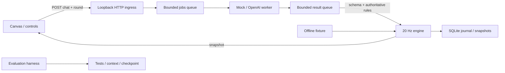

# Architecture

- `server/engine.py`: deterministic state machine; no I/O, clock, random source, or provider dependency. Tick is 50 ms; phase modulo 500. Only this engine changes gameplay state.
- `server/app.py`: loopback-only standard-library HTTP server; single simulation thread, one inference worker, bounded queues (64). Provider calls carry the captured round and telemetry diff; late results fail authoritative checks. Provider timeout 3 seconds. No provider call under engine lock.
- Persistence batches events outside the simulation lock; SQLite WAL. Local disk stalls can still delay scheduler; lateness is observable and catch-up is bounded. This is not a hard-real-time system.
- `storage/store.py`: append journal and snapshots. Events have server tick, match ID and database sequence; update/delete denied by SQLite triggers. Raw chat stays local. No credentials are journaled.
- `schemas/`: shared JSON Schema contracts and dependency-free validator for the used subset. No arbitrary generated tool invocation, shell execution, or eval. Model proposals can only choose four game actions.
- `client/`: plain ES module, Canvas 2D, 5 Hz state polling and requestAnimationFrame rendering. Local state never writes authoritative positions. UI telemetry uses textContent to prevent chat HTML injection. Web Audio oscillators provide planning (8-bit), action (synthwave), delivered (festival) states.
- `server/replay.py`: offline fixture and accepted-event replay; pure tick execution, independent of the HTTP server.
- `harness/`: development-only control loop. Reads task dependencies, requirement mappings and recent failures; validates contracts, runs checks, records source hashes, evaluation history and compact context. It does not generate code or run arbitrary task commands.

## Contracts and dependency rules
POST `/api/chat`: `schemas/request.json`; returns 202 queued or 400 rejection; acceptance appears in telemetry. GET `/api/state`: `schemas/telemetry.json`; GET `/api/health`: provider, fixture, clock metrics and runtime failure. Assets have a fixed allowlist. Cross-origin writes denied. Demo identity is client supplied; production authentication/rate-limiting belongs in a future Twitch ingress adapter.

Engine → schemas only. Providers → schemas + external HTTP (live only). Storage → SQLite only. Client → HTTP only. Game runtime must not import harness/evals/tests. Offline fixture explicitly forbids live provider mode. Run all commands from repository root. No automatic resume after crash: event journal and checkpoints support inspection/replay; restart creates a new match.
