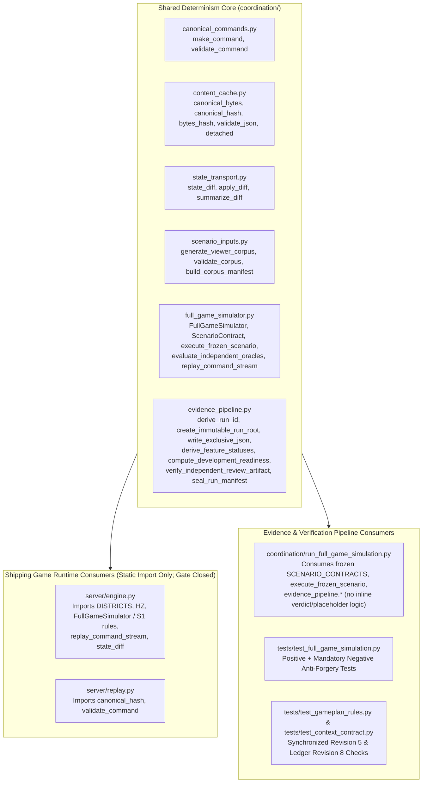

# 01_ARCHITECTURE — Objective, Shared Determinism Core (SDC) & Dual-Consumer Contract

## 1. Architectural Objective & Scope

Convert the nine accepted findings in [`docs/planning/SIMULATION-EVIDENCE-AUDIT.md`](SIMULATION-EVIDENCE-AUDIT.md) into a single-source-of-truth deterministic architecture where:

1. **Every deterministic primitive is implemented once** in the **Shared Determinism Core (SDC)** within `coordination/` and consumed by **both** the shipping game runtime (`server/engine.py`, `server/replay.py`) and the simulation evidence/verification pipeline (`coordination/run_full_game_simulation.py`, `tests/`).
2. **Evidence is mechanically derived, never asserted:** scenario contracts and concrete expected oracles are frozen and hashed *before* tick 0; every scenario emits replayable canonical command streams, `state_diff` traces, and boundary hashes; feature statuses (`passed`, `failed`, `not_observed`, `blocked_by_implementation`) and `DEVELOPMENT-READINESS.json.ready` are pure deterministic functions of observed gate artifacts.
3. **Anti-forgery guarantees are enforced in code and negative tests:** the simulation runner is physically incapable of authoring `INDEPENDENT-REVIEW.md`, marking `MODEL-USAGE.json` review calls completed without an external review receipt, overwriting an existing run directory, or backfilling missing command/trace files with summary placeholders.

### Explicit Exclusions
- **No modification of the rejected run:** `artifacts/simulations/full-game/full-game-20261101T102226Z-a8e33043/` is read-only preserved evidence verified by tree SHA-256 before and after every task.
- **No product feature development or live gameplay execution:** `server.app`, `server.replay`, `harness.run`, and browser gameplay are **not executed** (`AGENTS.md` gameplay gate remains closed). Exporting/wiring SDC primitives so `server/engine.py` imports them at module level is static code reuse, tested exclusively via pure unit/kernel tests without starting the server or running gameplay tests.
- **No live network/provider calls:** only the single authorized Astra/high independent review invocation via the configured subagent/executor boundary after freezing the new simulation bundle (`AUDIT-01`).

---

## 2. Shared Determinism Core (SDC) Module Boundary

Rather than inventing a parallel directory tree, the **Shared Determinism Core (SDC)** consolidates and extends the existing stdlib-only deterministic modules in `coordination/`:

### SDC Public Surface, Issue Mapping & Dual Consumers

| SDC Primitive / Symbol | Module Residence | Audited Issue(s) Resolved | Shipping Game Consumers | Evidence-Pipeline Consumers | Amortization Class |
|---|---|---|---|---|---|
| `FullGameSimulator` (with `synthetic_fixture_pool` isolation, `D-06` phase-boundary `operator.failover`/`operator.recover`, `D-07` strict 2-key `booth.hotfix` allowlist/version/expiry/rollback, and step/command `state_diff` trace recording) | `coordination/full_game_simulator.py` | `AUDIT-03`, `AUDIT-05`, `AUDIT-06` (`D-06`, `D-07`, `D-09`) | `server/engine.py` (imports `FullGameSimulator`, `DISTRICTS`, `HZ`, `TURN_TICKS` as authoritative S1 engine core) | `coordination/run_full_game_simulation.py`, `tests/test_full_game_simulation.py` | `NET_NEGATIVE` (eliminates inline scenario step loops and unifies S1 rules) |
| `ScenarioContract`, `freeze_scenario_matrix()`, `execute_frozen_scenario()`, `replay_command_stream()` | `coordination/full_game_simulator.py` | `AUDIT-02`, `AUDIT-05` | `server/engine.py` / `server/replay.py` (deterministic command-stream replay and state-diff verification) | `coordination/run_full_game_simulation.py` (executes all 46 scenarios via one runner), `tests/test_full_game_simulation.py` | `NET_NEGATIVE` (replaces ~1,000 lines of ad-hoc scenario boilerplate in `run_full_game_simulation.py` with declarative frozen contracts + 1 runner) |
| `evaluate_independent_oracles(contract, pre_state, post_state, command_log, trace_log)` | `coordination/full_game_simulator.py` | `AUDIT-02`, `AUDIT-03` | `server/engine.py` (runtime invariant self-check hook at turn/terminal boundaries) | `coordination/run_full_game_simulation.py`, `tests/test_full_game_simulation.py` | `NET_NEUTRAL` (decouples oracle verification from simulator internal flags) |
| `build_corpus_manifest(corpus, Retain/Recipe)` | `coordination/scenario_inputs.py` | `AUDIT-08` | `server/replay.py` / offline fixture loader (validates seeded viewer corpus digest before load) | `coordination/run_full_game_simulation.py` (`CORPUS-MANIFEST.json`), `tests/test_full_game_simulation.py` | `NET_NEUTRAL` (~15 lines, reuses existing `generate_viewer_corpus` / `validate_corpus`) |
| `derive_run_id()`, `create_immutable_run_root()`, `write_exclusive_bytes()`, `write_exclusive_json()` | `coordination/evidence_pipeline.py` | `AUDIT-09` | `storage/store.py` / match checkpoint export (immutable match bundle export) | `coordination/run_full_game_simulation.py`, `tests/test_full_game_simulation.py` | `NET_NEUTRAL` (replaces scattered `.write_text()` calls and `exist_ok=True`) |
| `derive_feature_statuses(feature_specs, scenario_results, render_observed=False, audio_observed=False, live_service_observed=False)` | `coordination/evidence_pipeline.py` | `AUDIT-04` | `server/app.py` `/api/health` capability readiness reporting (reports unconfigured live/render capabilities honestly) | `coordination/run_full_game_simulation.py` (`FEATURE-INVENTORY.json`, `COVERAGE.json`), `tests/test_full_game_simulation.py` | `NET_NEGATIVE` (replaces hardcoded status dictionaries) |
| `prepare_pending_review_packet()`, `verify_independent_review_artifact()`, `compute_development_readiness()`, `seal_run_manifest()` | `coordination/evidence_pipeline.py` | `AUDIT-01`, `AUDIT-07`, `AUDIT-09` | `harness/run.py` / release-gate evaluator (computes gate readiness from observed checks) | `coordination/run_full_game_simulation.py` (`REVIEW-PACKET.md`, `MODEL-USAGE.json`, `DEVELOPMENT-READINESS.json`, `RUN-MANIFEST.json`), `tests/test_full_game_simulation.py` | `NET_NEGATIVE` (removes synthetic review generator and hardcoded readiness dict) |

### What SDC Deliberately Does NOT Cover
- Browser Canvas 2D rendering (`client/app.js`), Web Audio oscillator synthesis, or CSS layout (`FEAT-14-READABILITY-AND-HUD` visual rendering).
- Live HTTP sockets (`server/app.py`), live OpenAI network calls (`server/providers.py`), or live Twitch EventSub/Extension JWT verification.
- Any modification to historical v1 plans (`GAMEPLAN-v1.md`, `rehearsal-v1/`) or the preserved rejected simulation run (`artifacts/simulations/full-game/full-game-20261101T102226Z-a8e33043/`).

---

## 3. Component Boundaries & Data Contracts

### 3.1 `AUDIT-03` Fix Contract: Fixture & Bot Provenance Isolation
- In `FullGameSimulator.__init__`:
  - `self.pool: int = 0` — Live human-origin fictional Hype pool (capped at `60`).
  - `self.synthetic_fixture_pool: int = 0` — Explicitly isolated synthetic illustration counter for `provenance == "fixture"` hazards (capped at `60`, never mixed into `self.pool` or `self.terminal_settlement["total_hype"]`).
- In `FullGameSimulator.submit_command` (`kind == "hazard.propose"`):
  - If `cmd["provenance"] == "bot"`: return `"rejected"` immediately (`INV-BOT-ISOLATION`).
  - If `cmd["provenance"] == "human"`: increment `self.pool = min(60, self.pool + 20)`.
  - If `cmd["provenance"] == "fixture"`: increment `self.synthetic_fixture_pool = min(60, self.synthetic_fixture_pool + 20)`; **`self.pool` remains unchanged (`+0`)**.
- In `_handle_delivery()`:
  - `self.terminal_settlement["total_hype"]`, `streamer_share`, and `audience_share_total` are computed strictly from `self.pool`. `synthetic_fixture_pool` is reported only under `self.terminal_settlement["synthetic_fixture_hype_illustrated"]` with `"live_participant_minted": False`.
- Independent Oracle (`INV-BOT-ISOLATION`):
  - Re-scans `command_history`: let $H_{\text{human}}$ be the count of distinct applied `hazard.propose` commands with `provenance == "human"` committed at `turn_tick < 300` (at most 1 per turn). Asserts `final_state["bounty"]["pool"] == min(60, 20 * H_{\text{human}})`. Any run where a `fixture` or `bot` command increases `pool` fails the independent oracle immediately.

### 3.2 `AUDIT-02` & `AUDIT-05` Fix Contract: Pre-Execution Frozen `SCENARIO-MATRIX.json` & Substantive Traces
- **Frozen Scenario Contract Schema (`ScenarioContract`):**
  - `scenario_id`: stable string (`SCEN-E2E-01` .. `SCEN-PRS-03`, 46 scenarios total).
  - `category`: one of the 9 mandatory categories.
  - `seed`: integer seed.
  - `initial_lane`: integer `0, 1, 2`.
  - `base_speed_override`: optional rational/float override (e.g., for forced-wipe scenarios `SCEN-E2E-02`, `SCEN-E2E-05`).
  - `initial_roster`: list of account IDs.
  - `scheduled_commands`: list of `{tick, kind, actor_id, provenance, sequence, payload}` or deterministic command-schedule recipe.
  - `steps_to_run`: integer max ticks or `"until_terminal_or_deadline"`.
  - `features_exercised`: list of `FEAT-NN-*` IDs actually exercised by this scenario's state transitions (excluding unrendered visual/audio claims).
  - `invariants_tested`: list of `INV-*` IDs.
  - `expected_oracle`: concrete dictionary of independent pre-declared expectations:
    - `expected_final_status`: `"racing" | "delivered" | "wiped"`
    - `expected_final_tick_range`: `[min_tick, max_tick]` (or exact `expected_final_tick`)
    - `expected_pool`: exact integer `0..60`
    - `expected_collisions_total`: exact integer `0..3`
    - `expected_command_statuses`: list/dict of expected return statuses (`applied`, `expired`, `rejected`, `duplicate`)
    - `expected_settlement`: optional dict (`total_hype`, `streamer_share`, `audience_share_total`, `audience_withheld`, `per_voter_rational`)
    - `expected_boundary_labels`: required boundary hash labels (`init`, `turn_1_resolution_start`, etc.)
- **Pre-Execution Freeze Discipline:**
  - `freeze_scenario_matrix(contracts, matrix_path)` serializes and writes `SCENARIO-MATRIX.json` (using `write_exclusive_json`) and returns `matrix_sha256 = bytes_hash(matrix_path.read_bytes())` **before** any `FullGameSimulator` instance is constructed or stepped.
  - `execute_frozen_scenario(contract, artifact_dir)` loads/verifies the frozen contract, executes the commands and ticks, records:
    1. `commands/<scenario_id>.json`: non-empty JSON object `{"scenario_id": ..., "contract_hash": ..., "seed": ..., "initial_state_hash": ..., "commands": [...]}` containing every submitted canonical command envelope and its authoritative return status, plus initial setup actions.
    2. `traces/<scenario_id>.jsonl`: non-empty JSONL file where each line is a substantive `state_diff` delta record (`{"tick": ..., "event_kind": ..., "delta": state_diff(prev_state, curr_state), "state_hash": ...}`) from `coordination/state_transport.py`, including at minimum the `init` boundary snapshot, every command/phase/event state transition delta, and the `terminal`/`final` boundary delta.
    3. `state-hashes/<scenario_id>.json`: boundary hashes (`init`, phase transitions, `final`) and independent oracle evaluation breakdown.
  - **Fail-Closed Anti-Placeholder Rule (`AUDIT-05`):**
    - The post-hoc fallback loop in `run_full_game_simulation.py:1588-1596` is **deleted**.
    - `verify_scenario_artifacts(scenario_id, artifact_dir)` asserts that `commands/<scenario_id>.json` and `traces/<scenario_id>.jsonl` exist, parse cleanly, contain `contract_hash`, `initial_state_hash`, `final_state_hash`, at least one `state_diff` record with `base_hash`/`result_hash`/`operations`, and are **never** the banned placeholder shapes `[{"scenario_id": ..., "execution_mode": "deterministic"}]` or summary-only JSONL.

### 3.3 `AUDIT-04` Fix Contract: Mechanically Derived Feature Coverage
- Each feature in `FEATURE_SPECS` declares:
  - `required_evidence_kind`: `"deterministic_state_and_commands"` vs `"render_capture_and_mobile_viewport"` (`FEAT-14`) vs `"acoustic_output_and_voiceover_capture"` (acoustic portion of `FEAT-13`) vs `"rendered_video_and_live_twitch_session"` (live/video portion of `FEAT-15`) vs `"visual_interpolation_render_capture"` (visual overlay portion of `FEAT-12`).
- `derive_feature_statuses(feature_specs, scenario_results, environment_capabilities)` computes each feature's `status` and `coverage_state` strictly from `scenario_results`:
  - Features with `required_evidence_kind == "deterministic_state_and_commands"` (`FEAT-01` through `FEAT-11`, `FEAT-16`, plus the state-machine/tick-alignment contracts of `FEAT-12`, `FEAT-13`, `FEAT-15` where scoped to engine state):
    - Marked `status: "passed", coverage_state: "covered"` **only if** `>= 1` scenario in `SCENARIO-RESULTS.jsonl` lists the `feature_id`, all such scenarios passed their independent oracle, and `0` failed.
  - Features requiring unexecuted render/audio/live capabilities in this headless deterministic simulation run:
    - `FEAT-14-READABILITY-AND-HUD`: appears in `0` render scenarios -> mechanically derived as `status: "not_observed"`, `coverage_state: "not_observed"`, `unobserved_reason: "No browser/mobile render capture or compressed-video readability observation in headless deterministic simulation"`.
    - `FEAT-12-BULLET-TIME-PRESENTATION`, `FEAT-13-ADAPTIVE-AUDIO`, `FEAT-15-PUBLIC-DEMO-TIMELINE`: state-machine/tick/claim-schema transitions are verified in scenarios, while visual overlay rendering, acoustic/voiceover intelligibility/mute, and 3-minute rendered video capture are explicitly recorded under `sub_claims` as `"not_observed"` so `COVERAGE.json` reports both `state_contract_covered_features: 15`, `fully_observed_features: 12`, `partially_observed_state_only_features: 3` (`FEAT-12`, `FEAT-13`, `FEAT-15`), and `not_observed_features: 1` (`FEAT-14`). `covered_features` is never falsely reported as `16/16 (100%)`.

### 3.4 `AUDIT-08` Fix Contract: Content-Addressed `CORPUS-MANIFEST.json`
- `build_corpus_manifest(seed=42, count=100000)` calls `generate_viewer_corpus(seed=42, count=100000)` and `validate_corpus(corpus)` from `coordination/scenario_inputs.py`, then writes:
  - `CORPUS-MANIFEST.json` containing:
    - `generator_id`: `"viewer-fixture-v1"`
    - `generator_version`: `1`
    - `generator_source_path`: `"coordination/scenario_inputs.py"`
    - `generator_source_sha256`: `file_sha256("coordination/scenario_inputs.py")`
    - `generator_spec_sha256`: `corpus["generator_hash"]` (64-hex SHA-256)
    - `template_sha256`: `corpus["template_hash"]` (64-hex SHA-256)
    - `seed`: `42`
    - `count`: `100000`
    - `start_tick`: `0`
    - `tick_stride`: `1`
    - `sha256`: `corpus["corpus_hash"]` (validated 64-char lowercase hex SHA-256 via `require_hash()`)
    - `regeneration_recipe`: `"from coordination.scenario_inputs import generate_viewer_corpus; generate_viewer_corpus(seed=42, count=100000)"`
    - `verified_regeneration_match`: `True` (verified by running `validate_corpus(corpus)` during manifest generation)

### 3.5 `AUDIT-01`, `AUDIT-07`, `AUDIT-09` Fix Contract: Immutable Run Lifecycle, Two-Stage Sealing, Genuine Astra Review & Derived Readiness
- **Phase A — Exclusive Run Initialization (`create_immutable_run_root`):**
  - Requires `authorize_token == "AUTHORIZE_COMPLETE_GAME_SIMULATION=true"`.
  - Computes `profile_first8 = file_sha256("docs/planning/S1-SIMULATION-PROFILE.md")[:8]`.
  - Generates `run_id = f"full-game-{utc_now_compact}-{profile_first8}"` (or explicit CLI `--run-id` that must not equal `full-game-20261101T102226Z-a8e33043` and must not already exist).
  - Creates `artifacts/simulations/full-game/<run_id>` with `mkdir(parents=True, exist_ok=False)`. Any existing directory raises `FileExistsError` immediately.
  - Every file write in the run directory uses `write_exclusive_bytes(path, data)` (`open(path, "xb")`), preventing any file from being overwritten once written.
- **Phase B — Pre-Review Simulation & Evidence Freeze (`--stage simulate`):**
  1. Write `AUTHORIZATION.md` and `SOURCE-BINDINGS.json`.
  2. Write `ASSUMPTIONS-AND-GAPS.md` and `HUMAN-DECISIONS.md` (reflecting delegated decisions `DECISION-01..04`).
  3. Generate, validate, and write `seeds.json` and `CORPUS-MANIFEST.json` (with real 64-hex `sha256`).
  4. Freeze and write `SCENARIO-MATRIX.json` (with concrete expected oracles for all 46 scenarios) and record its SHA-256 **before** tick 0.
  5. Execute all 46 frozen scenarios + golden replay verification; write `commands/<id>.json`, `traces/<id>.jsonl`, `state-hashes/<id>.json`, `state-hashes/scenario_hashes.json`, and `results/SCENARIO-RESULTS.jsonl`.
  6. Compute and write `INVARIANT-RESULTS.json`.
  7. Mechanically derive and write `FEATURE-INVENTORY.json` and `COVERAGE.json` from `SCENARIO-RESULTS.jsonl`.
  8. Write `ISSUES.json` (3 closed issues: `ISSUE-SIM-01`, `ISSUE-SIM-02`, `ISSUE-SIM-03` with real SHA-256 bindings), `PLAN-CHANGELOG.md`, `REMEDIATION-RESULTS.json`, `REGRESSION-RESULTS.json`, `CLAIMS-AND-PROVENANCE.json`, and `SIMULATION-REPORT.md`.
  9. Write `REVIEW-PACKET.md` binding the exact SHA-256 hashes of the frozen pre-review artifacts (`SOURCE-BINDINGS.json`, `FEATURE-INVENTORY.json`, `SCENARIO-MATRIX.json`, `CORPUS-MANIFEST.json`, `INVARIANT-RESULTS.json`, `COVERAGE.json`, `ISSUES.json`, `PLAN-CHANGELOG.md`, `REGRESSION-RESULTS.json`, `SIMULATION-REPORT.md`). Note: `REVIEW-PACKET.md` does **not** hash `DEVELOPMENT-READINESS.json` before it exists (`AUDIT-09` fix).
  10. Stop without creating `INDEPENDENT-REVIEW.md`, `DEVELOPMENT-READINESS.json`, or `RUN-MANIFEST.json`. The simulator **cannot** write `INDEPENDENT-REVIEW.md`.
- **Phase C — Genuine Independent Review Invocation (`TASK-009`, `AUDIT-01`):**
  - Compile the `plan_review` context-contract packet (`python3 -m coordination.context_contract --task plan_review --phase plan --owned-path artifacts/simulations/full-game/<run_id>/INDEPENDENT-REVIEW.md --owned-path artifacts/simulations/full-game/<run_id>/REVIEW-INVOCATION.json`).
  - Invoke an independent review subagent / configured executor boundary with fresh narrow context (`REVIEW-PACKET.md` and bound artifact paths).
  - The independent reviewer writes `INDEPENDENT-REVIEW.md` directly and records invocation provenance in `REVIEW-INVOCATION.json` (reviewer agent/conversation ID, packet hash, prompt hash, output hash, timestamp, verdict `READY` or `REVISE`).
- **Phase D — Post-Review Finalization & Manifest Sealing (`--stage finalize`, `TASK-008` / `TASK-009`):**
  1. `verify_independent_review_artifact(run_dir)` validates `INDEPENDENT-REVIEW.md` and `REVIEW-INVOCATION.json` (rejects any synthetic/self-authored review, verifies bound hashes match `REVIEW-PACKET.md`, extracts verdict `READY` or `REVISE`).
  2. Write `MODEL-USAGE.json` recording actual invocation status (`completed` only if `REVIEW-INVOCATION.json` is valid and bound).
  3. Compute and write `DEVELOPMENT-READINESS.json` via `compute_development_readiness(run_dir)` — a pure boolean conjunction of:
     - `all_s0_s1_blocking_s2_issues_closed == True`
     - `candidate_plan_revision == 5` and `require_hash(candidate_plan_hash)` matches `file_sha256("docs/planning/GAMEPLAN-v2.md")` and `file_sha256("docs/planning/gameplan-v2.json")`
     - `unresolved_blocking_decisions == []` (all `D-01..D-08` and `ISSUE-SIM-01..03` resolved for simulation/development gate in `docs/planning/DECISIONS.md`)
     - `all_18_invariants_passed == True`
     - `all_46_scenarios_passed == True` and `golden_replay_verified == True`
     - `corpus_hash_valid == True` and `all_46_traces_substantive == True`
     - `feature_coverage_honestly_derived == True`
     - `review_verdict == "READY"` and `independent_review_verified == True`
  4. Write `README.md` and finally seal `RUN-MANIFEST.json` last, hashing every file in `run_dir` after all files exist.
