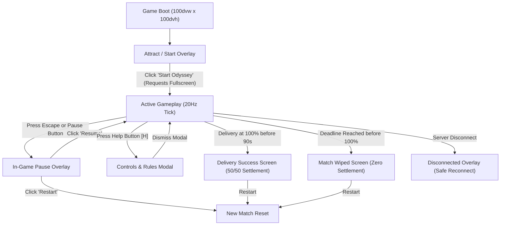

# TwitchCon Odyssey — Game Interface Master Plan & Execution Specification

**Status:** FROZEN  
**Date:** 2026-11-02  
**Base HEAD:** `bb02cea7e1c260eb30ea9491e7759761c0f290d4`  
**Ledger Revision:** 16  
**Execution Timebox:** 120 minutes  

---

## 1. Executive Summary & Authoritative Authorization

### 1.1 Authorization & Gate Status
On 2026-11-02, the requester issued the authoritative clarification:
> "Everything means including the blocked gate as well then ui and design"

This prompt and the directive ledger (Revision 16, directive `gate_to_game_interface_authorization_20261102`) establish explicit authorization for:
1. Reconciling the gameplay authorization gate to permit local gameplay execution, local service startup, browser gameplay, deterministic/local simulation, targeted gameplay/UI tests, and local desktop/mobile evidence capture.
2. Implementing a fullscreen, immersive, arcade-style TwitchCon Odyssey interface, eliminating the utilitarian "Google Maps application" aesthetic.
3. Operating within local dev and loopback environments only; no real Twitch chat, external network live-service calls, production deployment, PR merging, or publication is authorized.
4. Keeping `submission_ready: false` until a separate authorization and evidence predicate are satisfied.

### 1.2 Initial HEAD & Dirty Worktree Fingerprint
- **Base Commit:** `bb02cea7e1c260eb30ea9491e7759761c0f290d4`
- **Initial Status:** Dirty working tree containing pre-existing user-owned work across client, server, docs, and tests.
- **Fingerprint:** Tracked git status sha256 `b2f86f9fdd643f7e85a8204ef5fb5bf20cf7a59878a023f61aea52a66b90b95e`.
- **Preservation Directive:** All existing uncommitted files and modifications are preserved. No `git reset`, `git checkout --`, or destructive Git operations are permitted.

---

## 2. Observed Architecture & Current UI Deficiencies

### 2.1 Current Implementation Deficiencies
1. **Utilitarian "Google Maps" Layout:**
   - The game is framed inside a static HTML website page with a bulky top header, breadcrumbs, marketing headings ("One build. One route. Reach the fictional main stage."), explanatory paragraphs, telemetry cards, and a footer.
   - The game playfield is restricted to a fixed `<canvas id="game" width="1100" height="620">` box embedded in a card container.
   - The route is rendered on 2D canvas as a flat gray line with dashed road stripes and static geographic text labels ("SAN DIEGO BAY", "LITTLE ITALY", "GASLAMP QUARTER"), resembling a GPS navigation or Google Maps route planner rather than a high-stakes arcade delivery runner.
2. **Missing In-Game Controls & Menus:**
   - Controls and settings (Pause, Next Match, Sound, Bullet Time) are ordinary DOM buttons on an external website header.
   - There is no in-game pause overlay, settings modal, or controls guidance.
   - There is no start/attract screen; the game boots directly into a waiting state requiring external browser page scrolling.
3. **Primitive Player Character & World Presentation:**
   - The player character is a single green rectangle (`20×24` px) with a tiny sine-wave vertical bob.
   - Buildings are rendered as flat grid rectangles without depth, landmarks, or thematic flair.
   - The 3-lane structure (discrete lanes 0, 1, 2) is not diegetically visualized on the road surface, making lateral lane shifts feel disconnected from the environment.
   - Obstacles and hazards lack dramatic arcade warning, strobe indicators, and collision feedback.
4. **Non-Responsive / Viewport Issues:**
   - On mobile viewports (e.g. `390×844`), the page requires vertical scrolling to see both the canvas and the control buttons.
   - True fullscreen (`requestFullscreen`) is not utilized, and edge-to-edge layout (`100dvw × 100dvh`) is absent.

### 2.2 System & Architectural Strengths Retained
- **Deterministic Engine Authority (INV-01):** The Shared Determinism Core (`server/engine.py`, `coordination/deterministic_kernel.py`) owns all ticks, movements, lane positions (`avatar.lane`, `avatar.lateral_pos`), collisions, slowdowns, and hype settlement. The presentation layer remains strictly a reactive view.
- **Pure View Layer Contract (INV-03, INV-04):** `client/hud.js` derives all HUD views deterministically from the canonical state snapshot and server evidence envelope without mutating game state or inferring live mode from client state.
- **San Diego Thematic Consistency:** Districts (Little Italy / North Embarcadero, Waterfront, Gaslamp Quarter, Convention Center, Fictional Main Stage) and booth waypoints (Twitch booth 35%, Codex booth 60%, AWS booth 80%, Main Stage 100%) are retained.

---

## 3. Evidence & Research Syntheses

| Area | Primary Standard / Source | Key Design Implications |
|---|---|---|
| **Fullscreen API** | MDN / W3C Fullscreen API Specification | Web browsers require a transient user gesture (click/tap/keypress) to invoke `requestFullscreen()`. The game must provide an edge-to-edge default (`100dvw × 100dvh`) and bind `requestFullscreen()` to the primary "Start Odyssey" button, with graceful fallback if denied or unsupported. |
| **Viewport Units** | CSS Values Level 4 (`dvw`, `dvh`, `svh`) | Use `100dvw` and `100dvh` for dynamic mobile browser bar compensation, with `100vw`/`100vh` fallbacks. Prevent body scroll entirely (`overflow: hidden; touch-action: none`). |
| **Accessibility & Focus** | WCAG 2.1 AA / WAI-ARIA Modal Dialogs | Visible `:focus-visible` outlines (mint/cyan, 2px with 4px offset), semantic buttons, `aria-live="polite"` regions for feedback, keyboard trapping inside active modals, Escape key dismissal without leaking into gameplay commands. |
| **Reduced Motion** | CSS `prefers-reduced-motion: reduce` | Disable parallax scrolls, camera shakes, and rapid flash pulses. Provide static high-contrast borders and badge icons for all gameplay feedback. |
| **Input & Gamepad** | W3C Gamepad API & Pointer Events | Map Arrow keys and A/D keys for lane steering; support Gamepad D-pad (buttons 14/15) or Left Stick; provide large on-screen arcade touch pads (min 48×48px) for mobile devices. |
| **Twitch State Truthfulness** | Repository Evidence Contract | Twitch status must reflect only the server evidence context (`origin: 'fixture' \| 'live' \| 'disconnected'`). Never claim live participation without server-validated EventSub evidence. |

---

## 4. Goals, Non-Goals & Boundaries

### 4.1 Goals
1. **Fullscreen & Immersive:** Edge-to-edge `100dvw × 100dvh` responsive shell on desktop (`1440×1100`) and mobile (`390×844`) without browser scrollbars.
2. **In-Game Experience:** Start screen, Pause overlay, Help & Controls modal, Game Over / Victory celebration, audio toggle, and HUD controls integrated entirely inside the game viewport.
3. **Stylized San Diego World:** A vibrant synthwave/arcade runner presentation with perspective road lanes, San Diego dusk skyline (Coronado Bridge, palm trees, Bay water), landmark waypoint gates, and neon grid aesthetics.
4. **Expressive Player Courier:** A distinctive delivery courier sprite with running stride, lean on lane transition, shield sparks on collision/slowdown, and victory/defeat animations.
5. **Clear HUD & Telemetry:** Clear route progress bar, hazard countdown, consequence preview, hype counter, and honest mode labeling.
6. **Deterministic Authority:** 100% preservation of `AuthoritativeGame` tick semantics, lateral collision threshold (`|x - 1.0| < 0.4`), 20% slowdown for 2s, and one terminal settlement.

### 4.2 Non-Goals & Prohibitions
- No live Twitch network connections or real chat parsing in this run.
- No modifications to deterministic physics, speeds (`100/88` units/s), or timing intervals.
- No deployment, external push, PR creation, or Devpost submission.
- No deletion or weakening of existing tests.

---

## 5. Walkthroughs Across Key Stakeholder Roles



### 5.1 Player Perspective
- **Launch:** Instantly edge-to-edge. No reading wall of text; the start overlay provides a clear goal: "Deliver the build to the Main Stage before the 90s deadline!"
- **Steering:** Left/Right arrow keys or touch buttons shift between 3 discrete lanes. Immediate visual lean, sound blip, and lane indicator response.
- **Hazard:** Center-lane roadblock warning appears in the final 5s of planning. Steer to Lane 0 or Lane 2 to avoid collision.
- **Feedback:** Clear speed gauge, obstacle countdown, and collision alerts.

### 5.2 Streamer & Audience Perspective
- **Broadcast Composition:** High-contrast HUD designed for glanceability on stream. Clean upper-third status bar and lower-third touch/prompt layout.
- **Viewer Clarity:** When an audience vote is accepted, HUD shows `clear_lane` vote count and quorum threshold (`ceil(0.60 * N)`).
- **Honest Mode Labeling:** Clearly shows `OFFLINE FIXTURE` or `LIVE · VERIFIED TWITCH` based on the server evidence envelope.

### 5.3 Operator Perspective
- **Pause & Resume:** Instant simulation freeze via `operator.pause` canonical command. Clocks stop, commands reject, and no catch-up burst occurs on resume.
- **Restart:** Single click resets match state to tick 0.

---

## 6. Visual Design System & Thematic Style Guide

### 6.1 Palette
- **Deep Space Blue (Background):** `#070b12`
- **Neon Mint (Player, Success, High-Confidence):** `#a8f276`
- **Electric Purple / Cyan (Twitch, HUD Borders):** `#b59aff` / `#4deeea`
- **Amber Hazard (Warning, Obstacle, Slowdown):** `#ffb84d` / `#ff5c77`
- **San Diego Twilight (Sky Gradients):** Linear gradient from `#0b1021` to `#241738` with `#d45f78` sunset haze and deep blue bay water `#0a1926`.

### 6.2 Typography & Spacing
- **Display / Arcade:** Monospace sans-serif with geometric tracking (uppercase, letter-spacing `1.5px` to `2.5px`).
- **Body & Notes:** Modern system font (`system-ui, -apple-system, sans-serif`), font sizes 11px to 14px with line height `1.4`.
- **Touch Target Minimums:** All interactive buttons have minimum dimension `44×44px` (touch padding `48×48px` on mobile).

### 6.3 Layer Hierarchy
1. **Background Canvas Layer:** Sky gradient, Coronado Bridge silhouette, parallax city skyline, San Diego Bay reflections.
2. **Playfield Canvas Layer:** 3-lane road surface with perspective lines, neon lane markers, waypoint landmark gates, center-lane hazards.
3. **Character & Effects Layer:** Delivery runner silhouette, shadow, motion trails, collision sparks, waypoint banners.
4. **In-Game HUD Overlay (HTML/CSS):** Top navigation/progress bar, status chips, bottom controls bar.
5. **Modal & Screen Overlays (HTML/CSS):** Start Screen, Pause Screen, Settings/Help Modal, Terminal Victory/Wipe Modals.

---

## 7. Component Hierarchy & Data Ownership

```
[Window / Document]
  ├── #game-container (100dvw × 100dvh, relative, overflow: hidden)
  │     ├── canvas#game (Absolute, 100% width/height, scaled for DPR)
  │     ├── #hud-layer (Absolute, pointer-events: none)
  │     │     ├── header.hud-top (Brand, Mode Badge, Progress Meter, Phase, Hype)
  │     │     ├── div.hud-consequence (Hazard Warning, Action Preview, Status Note)
  │     │     └── footer.hud-bottom (Touch Lane Controls, Help & Pause Quick Toggles)
  │     └── #overlay-layer (Absolute, z-index: 50, flex/grid modals)
  │           ├── #start-modal (Attract screen, "Start Odyssey" button)
  │           ├── #pause-modal (Paused status, Resume / Restart buttons)
  │           ├── #help-modal (Controls guide, game rules, dismiss button)
  │           ├── #terminal-modal (Victory celebration / Wipe defeat screen)
  │           └── #disconnected-modal (Connection error recovery)
```

- **Authoritative Data (Server Engine):** State snapshot (`tick`, `turn`, `phase`, `status`, `movement.progress`, `avatar.lane`, `avatar.lateral_pos`, `hazard.*`, `bounty.pool`).
- **Presentation Data (Client View):** Camera scroll offset, particle effects, UI modal visibility, audio mute state, fullscreen state.

---

## 8. Swarm Task Breakdown & File Ownership

| Task ID | Owner | Assigned Files | Description | Acceptance Criteria |
|---|---|---|---|---|
| **TASK-UI-01** | Worker A | `docs/planning/GAME-INTERFACE-MASTER-PLAN.md` | Freeze design specs, visual hierarchy, color palette, and character rendering rules. | Comprehensive plan frozen before code changes. |
| **TASK-UI-02** | Worker B | `client/index.html`, `client/style.css` | Transform HTML/CSS into edge-to-edge `100dvw × 100dvh` game shell with embedded HUD and modal overlays. | No page scroll; all mandatory DOM IDs and accessibility attributes preserved; clean full-bleed styling. |
| **TASK-UI-03** | Worker B | `client/app.js` | Refactor game loop, responsive canvas sizing, arcade runner renderer, character animation, and modal state management. | Dynamic DPR canvas scaling; 3-lane perspective runner; smooth lane interpolation; in-game modals; fullscreen toggle. |
| **TASK-UI-04** | Worker C | `tests/test_presentation_capture.py`, `tools/capture_submission.py` | Verify responsive capture at `1440×1100` and `390×844`, test accessibility, and capture evidence in `evidence/ui-readiness/<timestamp>/`. | All static, responsive, and capture tests pass; evidence generated with SHA-256 manifests. |
| **TASK-UI-05** | Coordinator | `coordination/context_contract.py`, `config/directive-policy.json`, docs | Integration check, gate validation, full regression test execution, and final handoff. | All suites green; no regression in kernel or intake. |

---

## 9. Verification & Evidence Matrix

1. **Context Contract & Ledger:** `python3 -m coordination.context_contract --task planner_orchestrator --phase plan` compiles successfully.
2. **Offline Presentation Capture:** `python3 -m tools.capture_submission capture --mode fixture` and `capture --mode disconnected` generate valid desktop (`1440×1100`) and mobile (`390×844`) PNGs with 0 horizontal or vertical overflow.
3. **Accessibility Checks:** All 12 automated checks in `tools.capture_submission` pass (`html-lang`, `document-title`, `viewport-meta`, `accessible-button-names`, `steer-labels`, `canvas-label`, `live-regions`, `focus-visible`, `reduced-motion`, `no-horizontal-overflow`, `contrast`).
4. **Deterministic Kernel & Simulation:** `python3 -m unittest tests.test_context_contract tests.test_gameplan_rules tests.test_deterministic_kernel tests.test_full_game_simulation` all pass.
5. **Runtime Integration:** `python3 -m unittest tests.test_runtime_integration tests.test_presentation_capture` all pass.

---

## 10. Definition of Done
1. Stale gameplay gate reconciled with verbatim user wording and active directive; tested and verified.
2. Fullscreen, edge-to-edge `100dvw × 100dvh` game shell implemented with zero page scrollbars.
3. Controls, pause, restart, settings, instructions, and honest mode indicators fully accessible inside the game.
4. Stylized arcade runner aesthetic replaces utilitarian map layout.
5. Character silhouette, lane shifts, collision feedback, and waypoint landmarks clearly rendered.
6. Desktop and mobile viewports verified with Playwright screenshots saved to `evidence/ui-readiness/<timestamp>/`.
7. Deterministic mechanics preserved with zero regressions.
8. Single independent Astra review invoked and documented in `docs/planning/GAME-INTERFACE-ASTRA-REVIEW.md`.
