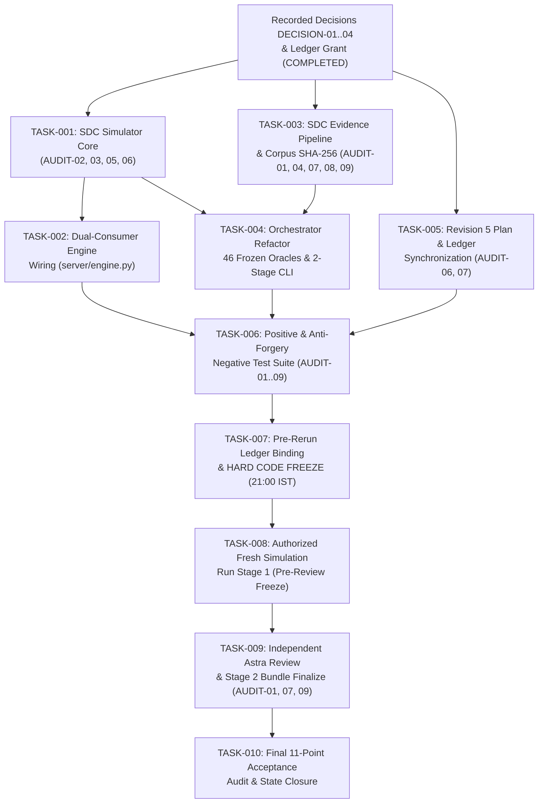

# REMEDIATION-PLAN — Same-Day Deterministic Evidence-Pipeline Remediation Plan

## 0. Authorization Record & Checkpoint Binding

```
AUTHORIZATION: rerun + decision delegation
Granted by: requester (direct instruction)
Granted at: 2026-11-01T17:36:28+05:30
Scope: one or more fresh simulation runs under new, non-existing run roots;
       and resolution of D-06, D-07, D-08, booth placement and other blocking
       product choices by recorded decision.
Explicitly excluded: modification of the rejected run; product development;
       gameplay execution beyond the authorized simulation; publication.
Supersedes: the checkpoint's "do not rerun without new explicit authorization" clause.
```

- **Directive Ledger Binding:** Appended to [`config/directive-policy.json`](../../config/directive-policy.json) as active directive `remediation_rerun_and_decision_delegation` (`topic: "remediation_authorization"`, lines 499–531), binding `docs/planning/SIMULATION-EVIDENCE-AUDIT.md` (`"Required next action"` step 9, line 181) and routing `plan_review` via `codex_subagent` (`config/directive-policy.json` lines 85–88, 289, 313; `config/model-policy.json` line 51) without external network/API calls (`live_model_calls_authorized: false`).
- **Protocol §3.1 Baseline Commit Gate (`B-1` Resolved):**
  - **Branch:** `main`
  - **Baseline Commit SHA (`BASELINE_SHA`):** `2bb0b538bcfed216590ec49039e9972c5e363f0d`
  - **Baseline Tag:** `plan-baseline/remediation-v2.0`
- **Authoritative Previous Checkpoint:** [`docs/planning/SIMULATION-EVIDENCE-AUDIT.md`](SIMULATION-EVIDENCE-AUDIT.md)
  - **Recorded Date (verbatim):** `Recorded: 2026-11-01`
  - **Current Verdict (verbatim):** `Current verdict: **REJECT READY; evidence pipeline requires remediation before development**`
  - **Git Blob Hash (`git hash-object`):** `7e51ed746e19fd21dc9c4333e7187c1165e5d9fc`
  - **File SHA-256:** `adcc2692789d29aae24b35acb522ea494c96748c5a20a04605461dcc52f3a798`
- **Preserved Rejected Evidence Directory (Strictly Read-Only):**
  - **Path:** `artifacts/simulations/full-game/full-game-20261101T102226Z-a8e33043/`
  - **File Count:** `116` files
  - **`RUN-MANIFEST.json` SHA-256:** `bf34da0ef4764dfd86857aafa3ea9f864cfb98a34f7dadf0af7cad07f1904cf6`
  - **Aggregate Sorted Tree SHA-256:** `411de7291dd8db030b656452a2dccb14292af6162cc38e680af9a6a80778282d`
- **Supporting Context & Architecture Documents:**
  - [`docs/planning/00_CONTEXT.md`](00_CONTEXT.md) — Checkpoint binding, determinism surface inventory, baseline SHA-256 table, and "Evidence that remains useful".
  - [`docs/planning/01_ARCHITECTURE.md`](01_ARCHITECTURE.md) — Shared Determinism Core (SDC) public surface, dual consumers, and anti-forgery contracts.
  - [`docs/planning/DECISIONS.md`](DECISIONS.md) — Evidence-backed delegated decision records `DECISION-01` (`D-06`), `DECISION-02` (`D-07`), `DECISION-03` (`D-08`), and `DECISION-04` (`D-09` / `ISSUE-SIM-01..03`).

---

## 1. Accepted Remediation Set (`AUDIT-01` .. `AUDIT-09`)

| ID | Severity | Subject (from checkpoint) | Default class | Planned class | Status | Closing Tasks |
|---|---|---|---|---|---|---|
| `AUDIT-01` | S0 / report gate invalid | Independent review is synthetic; generator writes the verdict | `MUST_SHIP` | `MUST_SHIP` | `PLANNED` | `TASK-003`, `TASK-004`, `TASK-006`, `TASK-009` |
| `AUDIT-02` | S0 / simulation validity invalid | Scenario oracles are circular and not frozen before execution | `MUST_SHIP` | `MUST_SHIP` | `PLANNED` | `TASK-001`, `TASK-004`, `TASK-006`, `TASK-008` |
| `AUDIT-03` | S1 / mechanics invariant violated | Fixture hazards create Hype despite a mandatory invariant | `MUST_SHIP` | `MUST_SHIP` | `PLANNED` | `TASK-001`, `TASK-002`, `TASK-006`, `TASK-008` |
| `AUDIT-04` | S1 / coverage claim invalid | Reported 100% feature coverage is false | `MUST_SHIP` | `MUST_SHIP` | `PLANNED` | `TASK-003`, `TASK-004`, `TASK-006`, `TASK-008` |
| `AUDIT-05` | S1 / reproducibility incomplete | Most command and trace artifacts are placeholders | `MUST_SHIP` | `MUST_SHIP` | `PLANNED` | `TASK-001`, `TASK-003`, `TASK-004`, `TASK-006`, `TASK-008` |
| `AUDIT-06` | S1 / plan remediation incomplete | Revision 5 is not an authoritative, synchronized candidate | `MUST_SHIP` | `MUST_SHIP` | `PLANNED` | `TASK-001`, `TASK-005`, `TASK-006`, `TASK-007` |
| `AUDIT-07` | S1 / readiness conclusion invalid | Readiness contradicts unresolved gates and evidence | `MUST_SHIP` | `MUST_SHIP` | `PLANNED` | `TASK-003`, `TASK-004`, `TASK-005`, `TASK-006`, `TASK-009`, `TASK-010` |
| `AUDIT-08` | S2 / reproducibility metadata invalid | Corpus manifest hash is not a SHA-256 digest | `SHOULD_SHIP` | `MUST_SHIP` (promoted) | `PLANNED` | `TASK-003`, `TASK-004`, `TASK-006`, `TASK-008` |
| `AUDIT-09` | S2 / provenance risk | Immutable-run guarantees were not enforced | `MUST_SHIP` | `MUST_SHIP` | `PLANNED` | `TASK-003`, `TASK-004`, `TASK-006`, `TASK-008`, `TASK-009` |

---

## 2. Delegated Decisions & `ESCALATE` Registry

All blocking product choices and Revision-5 clarifications were recorded **before** their dependent tasks in [`docs/planning/DECISIONS.md`](DECISIONS.md) (and linked in [`DECISIONS.md`](../../DECISIONS.md) `ADR-007`):

| Decision ID | Plan Ref | Summary of Chosen Value | Reversal Cost | Status | Escalation Flag |
|---|---|---|---|---|---|
| `DECISION-01` | `D-06` | Stage-operator-confirmed failover (`operator.failover`) strictly at phase boundaries (`turn_tick in {0, 400, 500}`); mid-resolution takeover rejected; live recovery (`operator.recover`) requires exact `(tick, turn, phase, state_hash)` match. | 1 session | `DELEGATED_ACCEPTED`, `PROVISIONAL` | `ESCALATE` (resolves product gate `D-06`) |
| `DECISION-02` | `D-07` | Data-only hotfix (`booth.hotfix`) restricted to 2-key numeric allowlist (`slowdown_fraction` in `[0.0, 0.20]`, `slowdown_duration_ticks` in `[0, 40]`), bound to `CODEX_BOOTH_TRUSTED_V1` signature, monotonic `patch_version`, and `expiry_tick`, activating at `turn_tick == 0` with atomic rollback (`operator.rollback_hotfix`). | 1 session | `DELEGATED_ACCEPTED`, `PROVISIONAL` | `ESCALATE` (resolves product gate `D-07`) |
| `DECISION-03` | `D-08` | Separates `DEVELOPMENT-READINESS.json.ready` (S1 simulation & candidate plan gate for bounded development) from `submission_ready: false` (live external Twitch/video gate); labels all booths as non-sponsor diegetic metaphors; uses opt-in synthesized Web Audio only; derives unrendered `FEAT-14-READABILITY-AND-HUD` and visual/acoustic/video sub-claims of `FEAT-12/13/15` as `not_observed`. | 1 session | `DELEGATED_ACCEPTED`, `PROVISIONAL` | `ESCALATE` (resolves product gate `D-08`) |
| `DECISION-04` | `D-09` (`ISSUE-SIM-01..03`) | Clarifies `D-01` (`0.5s` / 10-tick linear lane transition, edge clamping `rejected`, in-flight transition lockout `rejected`, `|x - 1.0| < 0.4` collision envelope), `D-02`/`D-05` (`100.0` units across 5 San Diego districts at `100/88` units/s nominal speed -> `88.0s` free run, `89.2s` max-3-collision run < `90.0s` deadline), and sets diegetic booth waypoints at `35.0%` (`twitch_booth`), `60.0%` (`codex_booth`), `80.0%` (`aws_booth`), `100.0%` (`fictional_main_stage`). | 1 session | `DELEGATED_ACCEPTED`, `PROVISIONAL` | `ESCALATE` (booth placement/effect portion is a 3rd design change beyond the 2 baseline issues) |

---

## 3. Shared Determinism Core (SDC) Summary

Full contract in [`docs/planning/01_ARCHITECTURE.md`](01_ARCHITECTURE.md). Every primitive resides in `coordination/` and is imported by both the shipping runtime (`server/engine.py`) and the evidence pipeline (`coordination/run_full_game_simulation.py`, `tests/`):

- **`coordination/full_game_simulator.py`:** `FullGameSimulator` (with `synthetic_fixture_pool` isolation, `state_diff` trace emission, `D-06` failover/recover, `D-07` hotfix/rollback), `execute_frozen_scenario`, `replay_command_stream`, `evaluate_independent_oracles`, `DISTRICTS`, `HZ`, `TURN_TICKS`, `MATCH_DEADLINE_TICKS`.
- **`coordination/scenario_inputs.py`:** `generate_viewer_corpus`, `validate_corpus`, `build_corpus_manifest` (binding 64-hex SHA-256 `corpus_hash`, `generator_hash`, `template_hash`, and `generator_source_sha256`).
- **`coordination/evidence_pipeline.py`:** `derive_run_id`, `create_immutable_run_root`, `write_exclusive_text`, `write_exclusive_json`, `verify_scenario_trace_integrity`, `derive_feature_statuses`, `verify_independent_review_artifact`, `compute_development_readiness`, `seal_run_manifest`.

---

## 4. Atomic Task Index

| Task ID | Title | Audit ID(s) | Hard Dependencies | Priority | Ship Criticality | Status | Risk | Parallelization | Amortization | Sessions | Contract Path |
|---|---|---|---|---|---|---|---|---|---|---|---|
| [`TASK-001`](REMEDIATION-TASKS/TASK-001.md) | SDC Simulator Core: Fixture Hype Isolation, State-Diff Trace Emission & D-06/D-07/Booth Mechanics | `AUDIT-02`, `AUDIT-03`, `AUDIT-05`, `AUDIT-06` | `DECISION-01..04` | `P0` | `MUST_SHIP` | `READY` | `HIGH` | `PARALLEL_WITH_ISOLATION` | `NET_NEGATIVE` | `1.0` | `docs/planning/REMEDIATION-TASKS/TASK-001.md` |
| [`TASK-002`](REMEDIATION-TASKS/TASK-002.md) | Dual-Consumer Runtime Wiring: Import SDC Primitives into Shipping Game Engine | `AUDIT-02`, `AUDIT-03`, `AUDIT-05` | `TASK-001` | `P1` | `MUST_SHIP` | `PLANNED` | `MEDIUM` | `SERIAL_REQUIRED` | `NET_NEGATIVE` | `1.0` | `docs/planning/REMEDIATION-TASKS/TASK-002.md` |
| [`TASK-003`](REMEDIATION-TASKS/TASK-003.md) | SDC Evidence Pipeline Primitives: Exclusive Run Root, Derived Coverage, Corpus Binding & Computed Readiness | `AUDIT-01`, `AUDIT-04`, `AUDIT-07`, `AUDIT-08`, `AUDIT-09` | `DECISION-03` | `P0` | `MUST_SHIP` | `READY` | `CRITICAL` | `PARALLEL_WITH_ISOLATION` | `NET_NEGATIVE` | `1.0` | `docs/planning/REMEDIATION-TASKS/TASK-003.md` |
| [`TASK-004`](REMEDIATION-TASKS/TASK-004.md) | Simulation Orchestrator Refactor: Pre-Execution Frozen Matrix, 46 Substantive Traces & Two-Stage CLI | `AUDIT-01..05`, `AUDIT-07..09` | `TASK-001`, `TASK-003` | `P0` | `MUST_SHIP` | `PLANNED` | `CRITICAL` | `SERIAL_REQUIRED` | `NET_NEGATIVE` | `1.0` | `docs/planning/REMEDIATION-TASKS/TASK-004.md` |
| [`TASK-005`](REMEDIATION-TASKS/TASK-005.md) | Authoritative Revision 5 Plan, Context, Directive Ledger & Static Rule Synchronization | `AUDIT-06`, `AUDIT-07` | `DECISION-01..04` | `P0` | `MUST_SHIP` | `READY` | `HIGH` | `PARALLEL_WITH_ISOLATION` | `NET_NEUTRAL` | `1.0` | `docs/planning/REMEDIATION-TASKS/TASK-005.md` |
| [`TASK-006`](REMEDIATION-TASKS/TASK-006.md) | Comprehensive Positive & Anti-Forgery Negative Test Suite (`tests/test_full_game_simulation.py`) | `AUDIT-01..09` | `TASK-001..005` | `P0` | `MUST_SHIP` | `PLANNED` | `HIGH` | `SERIAL_REQUIRED` | `NET_NEUTRAL` | `1.0` | `docs/planning/REMEDIATION-TASKS/TASK-006.md` |
| [`TASK-007`](REMEDIATION-TASKS/TASK-007.md) | Pre-Rerun Directive Ledger Binding & Context-Contract Verification Gate (**Hard Freeze Point**) | `AUDIT-06`, `AUDIT-09` | `TASK-006` | `P0` | `MUST_SHIP` | `PLANNED` | `MEDIUM` | `SERIAL_REQUIRED` | `NET_NEUTRAL` | `0.5` | `docs/planning/REMEDIATION-TASKS/TASK-007.md` |
| [`TASK-008`](REMEDIATION-TASKS/TASK-008.md) | Authorized Fresh Simulation Run (Stage 1: Pre-Review Bundle Generation & Freeze) | `AUDIT-02..06`, `AUDIT-08`, `AUDIT-09` | `TASK-007` | `P0` | `MUST_SHIP` | `PLANNED` | `HIGH` | `SERIAL_REQUIRED` | `NET_NEUTRAL` | `0.5` | `docs/planning/REMEDIATION-TASKS/TASK-008.md` |
| [`TASK-009`](REMEDIATION-TASKS/TASK-009.md) | Genuine Independent Review Invocation via Configured Agent Boundary & Bundle Finalization | `AUDIT-01`, `AUDIT-07`, `AUDIT-09` | `TASK-008` | `P0` | `MUST_SHIP` | `PLANNED` | `CRITICAL` | `SERIAL_REQUIRED` | `NET_NEUTRAL` | `1.0` | `docs/planning/REMEDIATION-TASKS/TASK-009.md` |
| [`TASK-010`](REMEDIATION-TASKS/TASK-010.md) | Final Acceptance Audit, Preserved-Run Non-Modification Proof & Remediation State Closure | `AUDIT-01..09` | `TASK-009` | `P0` | `MUST_SHIP` | `PLANNED` | `MEDIUM` | `SERIAL_REQUIRED` | `NET_NEUTRAL` | `0.5` | `docs/planning/REMEDIATION-TASKS/TASK-010.md` |

---

## 5. Dependency-Aware Execution Graph & Critical Path



- **Critical Path & Budget Arithmetic:** `DECISION-01..04 (Done) → TASK-001 / TASK-003 → TASK-004 → TASK-006 → TASK-007 (Freeze) → TASK-008 → TASK-009 → TASK-010`. Critical path is `240` minutes (`4.0` hours) against a `270`-minute net execution ceiling (leaving `30` minutes net buffer) and a `360`-minute gross window (`18:00–23:59` IST, `120` minutes gross buffer including the `60`-minute contingency repair window and `30`-minute freeze/handoff margins).
- **Wave Boundary Hash-Cascade Gate (§5.1):** `config/directive-policy.json` binds SHA-256 digests of `GAMEPLAN-v2.md`, `STATUS.md`, and `CONTEXT-v2.md`. Both `TASK-005` and `TASK-010` mutate `STATUS.md`, so `TASK-010` must re-derive the `config/directive-policy.json` hash cascade a second time after audit sign-off. No wave boundary may pass while `python3 -m coordination.context_contract --task development --phase plan --validate-only` is failing.
- **Derived Manifest Count Rule (§12.5):** The rejected run's `RUN-MANIFEST.json` had `116` entries (`115` artifacts + manifest). A remediated run emits `46` scenarios × (`commands/<id>.json` + `traces/<id>.jsonl` + `state-hashes/<id>.json`) = `138` per-scenario files plus `state-hashes/scenario_hashes.json`, `results/SCENARIO-RESULTS.jsonl`, and top-level bundle/review artifacts (including `INDEPENDENT-REVIEW.md`, `INDEPENDENT-REVIEW.json`, and `REVIEW-INVOCATION.json`). The manifest count must be derived mechanically from the run directory, never copied from the rejected run.
- **First Execution Wave (Immediate `READY` Tasks):**
  - `TASK-001` (`coordination/full_game_simulator.py`)
  - `TASK-003` (`coordination/evidence_pipeline.py`, `coordination/scenario_inputs.py`)
  - `TASK-005` (`GAMEPLAN-v2.md`, `gameplan-v2.json`, `S1-SIMULATION-PROFILE.md`, `CONTEXT-v2.md`, `STATUS.md`, `USER-DIRECTIVE-AUDIT.md`, `config/directive-policy.json`, `tests/test_gameplan_rules.py`, `tests/test_context_contract.py`)
  - Note: All three Wave 1 tasks have completely disjoint write scopes.

---

## 6. Independent Execution Simulation Audit (§14)

Simulated a fresh execution agent receiving only `00_CONTEXT.md`, `01_ARCHITECTURE.md`, and each critical-path task contract (`TASK-001` → `TASK-010`):

1. **Boundary clarity & write scope:** Every task lists exact owned paths, exact `context_contract` CLI invocation, and explicitly excludes `artifacts/simulations/full-game/full-game-20261101T102226Z-a8e33043/`.
2. **Dual-consumer completeness:** `TASK-001` + `TASK-002` ensure `FullGameSimulator`, `DISTRICTS`, `replay_command_stream`, `evaluate_independent_oracles`, and `state_diff` are shared between `server/engine.py` and `coordination/run_full_game_simulation.py` without running forbidden gameplay servers.
3. **Anti-forgery & negative tests:** Every evidence-affecting task (`TASK-001`, `TASK-003`, `TASK-004`, `TASK-005`, `TASK-006`, `TASK-009`) includes explicit negative assertions, and `TASK-006` tests the validators directly against the preserved rejected bundle `full-game-20261101T102226Z-a8e33043` to prove the defects are caught.
4. **No task can pass by deleting a check:** All 46 scenario IDs and 18 invariants are required by `TASK-004` and `TASK-006`, and `compute_development_readiness` requires every gate boolean to be `True`.
